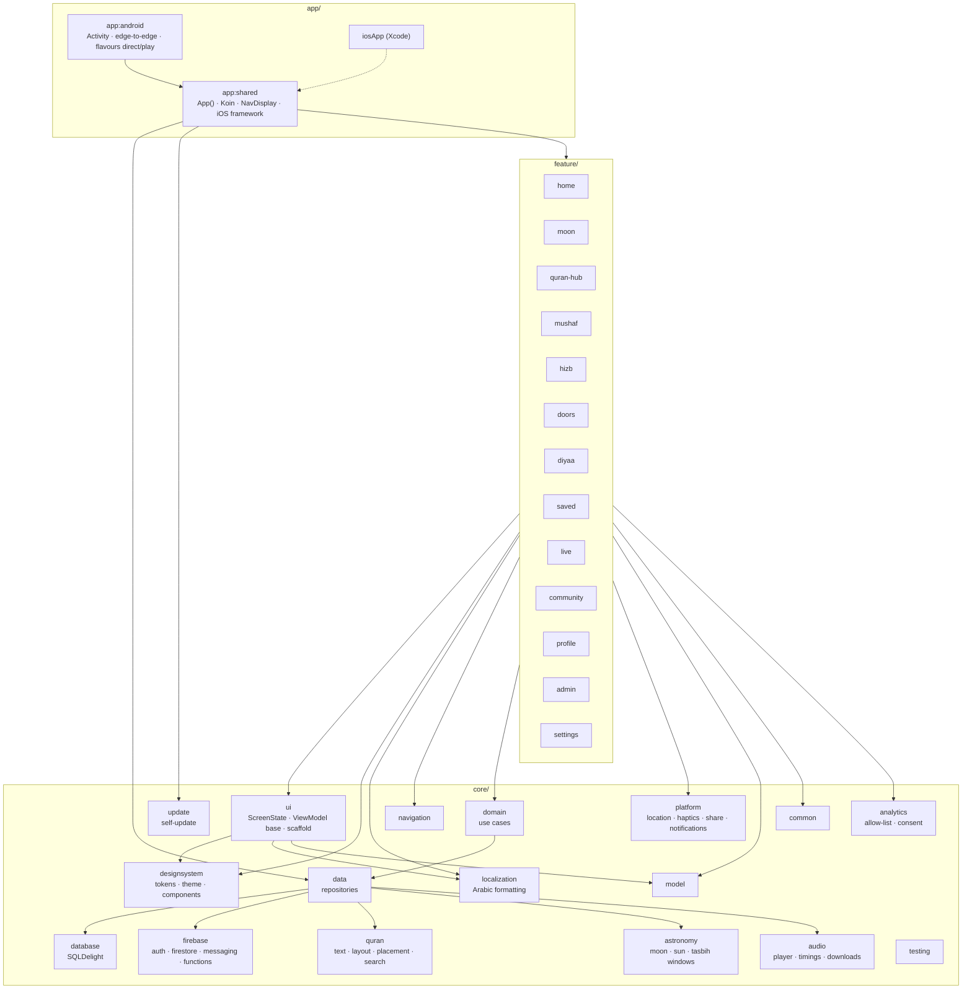

# Architecture overview

One Kotlin Multiplatform codebase, one shared Compose Multiplatform UI, Arabic and right to left throughout. Modules are split by **layer** (`core/*`) and by **screen** (`feature/*`), with thin application shells. Firebase serves only the networked parts; everything else works offline from data on the device. Decisions: [ADR 0011](../adr/0011-architecture-from-sojourn.md) and the ADRs it links.

## Shape

Arrows mean "may depend on". Anything not drawn is forbidden and checked by Konsist.

- **Features never see infrastructure.** They call use cases from `core:domain`. A screen cannot query the database, Firestore or the network directly.
- **Material lives in one place.** Only `core:designsystem` imports Material 3; screens compose its components.
- **The Quran engine is its own module.** `core:quran` owns the text, the page layout, quote placement and search; it has no UI and is tested in isolation.

## Layers

### Presentation (MVI)

One ViewModel per screen with `State`, `Intent` and `Effect`; a stateful `XxxRoute` and a stateless `XxxScreen(state, onIntent)`. Data-bearing screens model `ScreenState<T>` (Loading, Content, Empty, Error, Offline) exhaustively, plus feature states such as no-location or signed-out.

### Navigation

Navigation 3. Keys are `@Serializable` in `core:navigation`; each feature contributes entries; `app:shared` assembles the `NavDisplay`. Deep links from notifications (a post, a thread at a reply, a live card, the update sheet) build a sensible back stack.

### Data

- **On the device (SQLDelight), source of truth:** reading positions (Mushaf and Hizb separately), saved items, settings, downloads, the «تذكرة» shuffle bag, reading time, the last known lives list, the Firestore caches.
- **Bundled read-only assets:** the Quran text, page layout and fonts (ADR 0004), the content data (`design/data`), the city list.
- **Firestore (networked only):** Community, Admin, lives and videos, synced Saved, `app/latest`. Security rules and Cloud Functions enforce permissions (ADR 0006).
- **Quran Foundation through our Cloud Function:** recitation records and timings (ADR 0007); audio files streamed or downloaded to private storage.

### Quran engine (`core:quran`)

- **Text:** Tanzil simple (matching base) and the King Fahd Hafs text (display), read with normalisation at load time.
- **Pages:** QUL layout rows (page, line, type, centred, first and last word) joined to word glyphs; each page drawn with its QPC V2 font. One composable per word, so selection, the playing word, dimming and dark mode are per-word state.
- **Placement:** every quote and highlight in the content data is placed by word range and checked by a letter-skeleton match at build time.
- **Search:** an offline index over normalised text, surah names and jumps.

### Astronomy (`core:astronomy`)

Pure computation from time and place: moon phase, lit fraction, distance, rise and set with azimuths, sun times and twilight, the lunar-night rule, notable moments, and the «أوقات التسبيح» windows.

### Platform adapters (`core:platform`)

`expect` interfaces with Android and iOS implementations: approximate location, haptics, the share sheet, local notifications, reduced motion, opening TikTok or a URL, the package installer (Android `direct` flavour only, ADR 0010).

### Application shells

- `app:shared`: `App()` (theme, Koin, `NavDisplay`), `MainViewController()` for iOS.
- `app:android`: one Activity, edge-to-edge, predictive back, the `direct` and `play` flavours.
- `iosApp`: Xcode project hosting the shared framework.

## Enforcement

| Rule | Tool |
|---|---|
| Module graph above | Konsist |
| No Material outside `core:designsystem` | Konsist |
| Tokens, motion, direction, text and inset rules | detekt custom rules |
| Quran quotes and highlights placed exactly | build-time tests in `core:quran` |
| Token contrast in both themes | unit test |
| Koin graph complete | Koin `verify()` |
| Firestore permissions | rules tests in the Firebase emulator |
| Analytics events only from the plan, only after consent | wrapper tests |
| Visual regressions (light/dark × 100%/130% × two widths) | Roborazzi, Android and iOS |
| Performance budgets | Macrobenchmark (from Phase 10) |
| Everything above on every PR | GitHub Actions |
